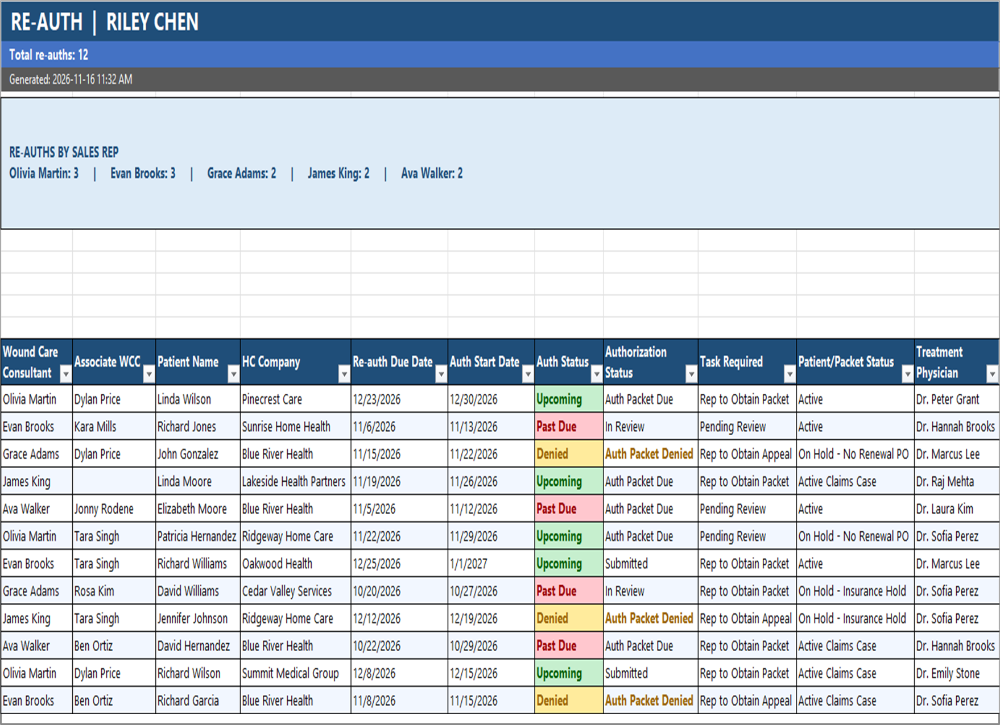
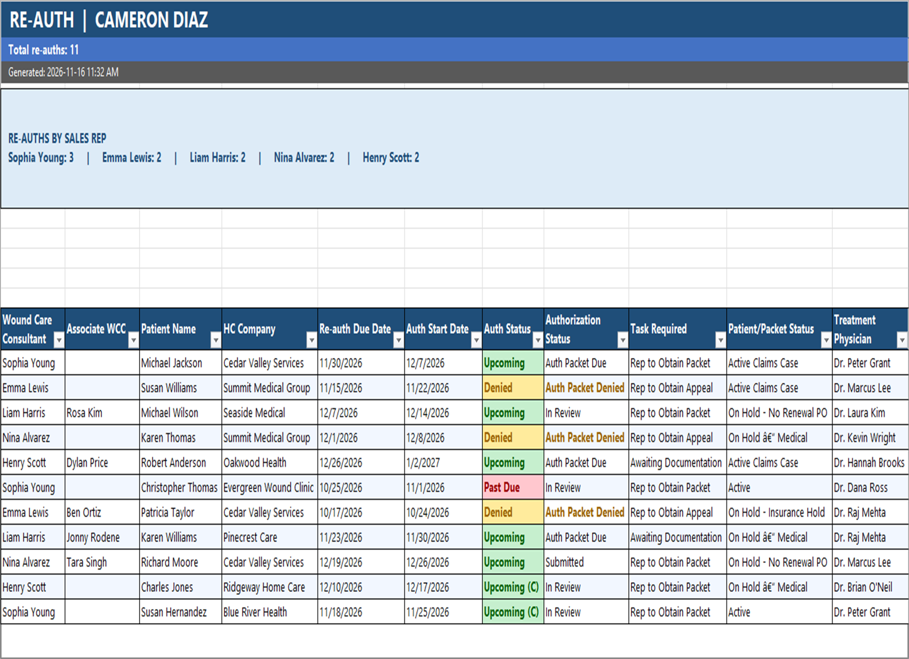
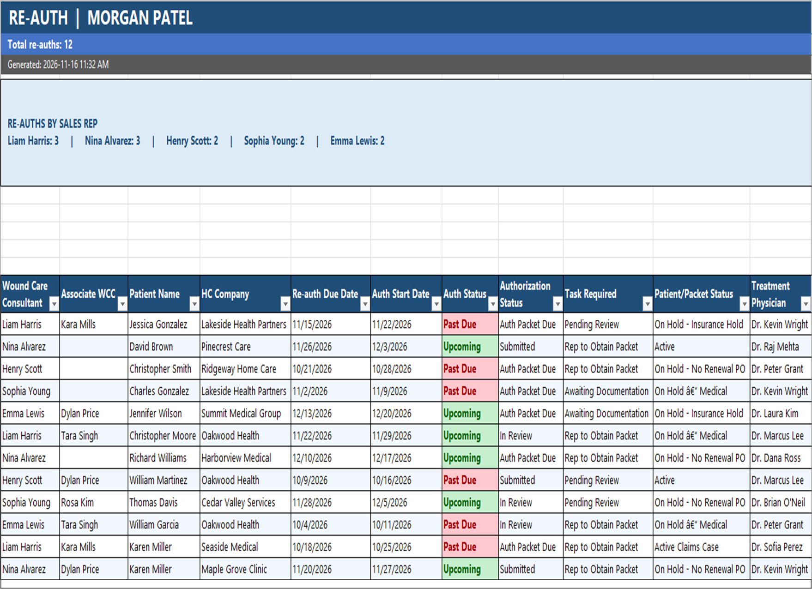
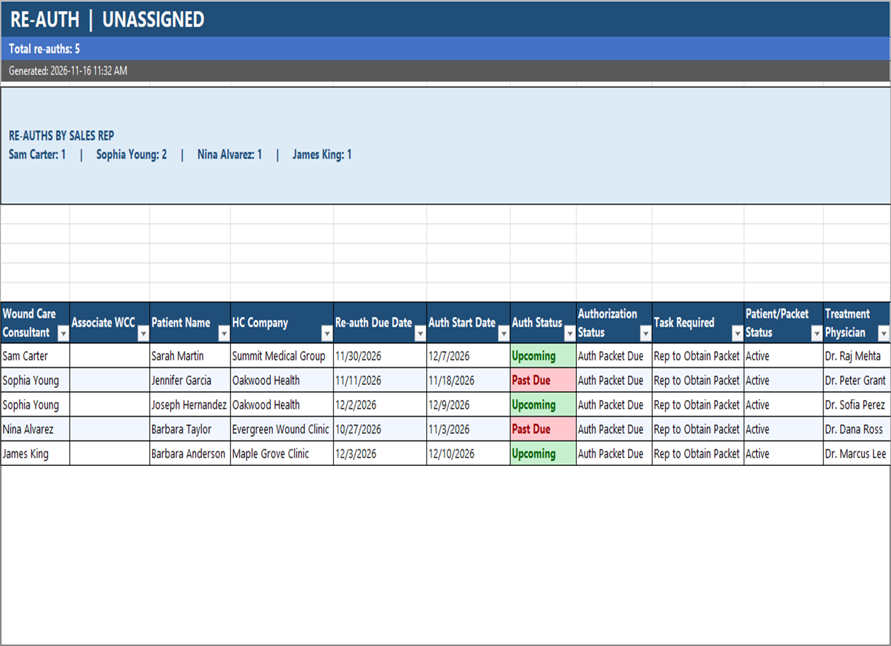
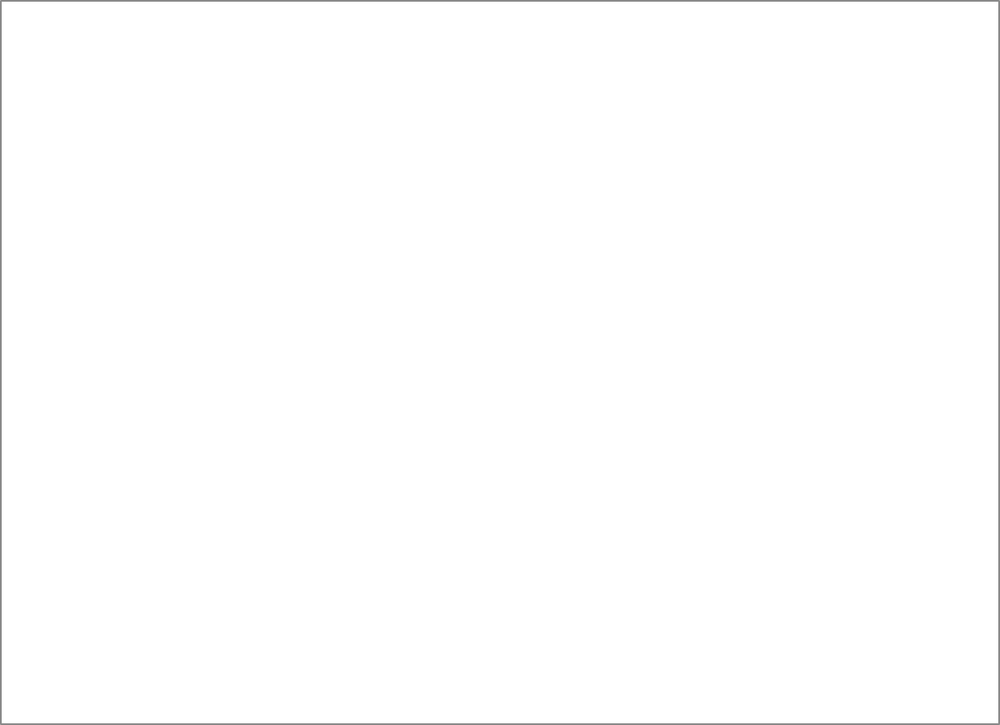

# Re-Auth Report Builder

Automated Excel/VBA report builder for **weekly pending and upcoming patient re-authorizations**. It converts a raw re-auth export (CSV/Excel) into a formatted workbook with a **Dashboard**, one **manager tab** per Assigned Sales Manager (plus `Unassigned`), and a **Raw Data** tab.

> **GitHub note:** GitHub renders repository README content below the file browser by design; this README is kept at repo root so the overview and screenshots appear immediately in that section.

## Screenshots

Captured from a generated report (`Reports\ReAuth_Report_2026-11-16_1132.xlsx`, sample/fake data) using `scripts\snapshot-report.py`.

### Dashboard


### Manager tab example
Each manager gets a dedicated tab with a rep summary, a single header row (row 15), and filtered/formatted data.


### More manager tabs
<details>
<summary>Show additional manager screenshots</summary>










</details>

### Raw Data


## Quick start

### End users (Excel)
1. Open **`Re-Auth Template.xlsm`** (Windows desktop Excel) and enable macros.
2. Click **`CREATE RE-AUTH REPORT`** on **`START HERE`**.
3. Select the raw re-auth export (`.csv`, `.xlsx`, `.xlsm`, `.xls`).
4. Output is saved to `Reports\ReAuth_Report_YYYY-mm-dd_HHMM.xlsx`.

### Maintainers (unattended run)
Prereqs: Windows + Excel + Python 3 + `pywin32`.

```powershell
cd "C:\Users\smd32\Downloads\Re-Auth Project"
python .\scripts\sync_template.py
python .\scripts\test-compile.py
python .\scripts\run-report.py --source ".\reauth raw.csv"
python .\scripts\snapshot-report.py
```

## Input data
- **Supported:** `.csv`, `.xlsx`, `.xlsm`, `.xls` (blank cells allowed).
- **Required headers (detected):** `Assigned Sales Manager`, `Auth Status`, `Patient Name`, `Re-auth Due Date`.
- **Grouping:** rows grouped by `Assigned Sales Manager`; blank -> `Unassigned`.
- **Status bucketing:** `Auth Status` categorized as Past Due / Upcoming / Denied / Other (case-insensitive contains).
- **Dates:** key date fields normalized/formatted when parseable (e.g. `Re-auth Due Date`, `Auth Start Date`).

Sample/fake input: `reauth raw.csv`.

## Output specification
Each run creates `Reports\ReAuth_Report_YYYY-mm-dd_HHMM.xlsx` with:
1. **Dashboard** – title/timestamp/source, KPI cards (`TOTAL RE-AUTHS`, `PAST DUE`, `UPCOMING`, `DENIED`, `OTHER`), manager breakdown (Total, Past Due, % Past Due, link to tab) aligned edge-to-edge across A:J.
2. **Manager tabs** (one per manager, sorted; includes `Unassigned`) – title/total/timestamp, **RE-AUTHS BY SALES REP** summary block, table header at row 15 with data from row 16, frozen at `A16`, autofilter.
   - Columns: `Wound Care Consultant`, `Associate WCC`, `Patient Name`, `HC Company`, `Re-auth Due Date`, `Auth Start Date`, `Auth Status`, `Authorization Status`, `Task Required`, `Patient/Packet Status`, `Treatment Physician`.
   - Manager/denial/qty/NPI fields remain in Raw Data (not duplicated on manager tabs).
3. **Raw Data** – all rows/columns in original order, formatted and filterable.

## Repository layout
| Path | Purpose |
|---|---|
| `Re-Auth Template.xlsm` | Master macro-enabled template (START HERE + embedded VBA) |
| `modCore.bas`, `modDeclarations.bas`, `modFormatting.bas`, `modLogging.bas`, `modUtils.bas` | VBA source of truth |
| `scripts/sync_template.py` | Import `mod*.bas` into template and refresh button |
| `scripts/run-report.py` | Unattended COM harness (dialogs/watchdog/logs) |
| `scripts/test-compile.py`, `scripts/watch-compile-error.py` | VBA compile checks/dialog capture |
| `scripts/answer-dialogs.py` | Excel/VBA dialog auto-answer helper |
| `scripts/snapshot-report.py` | Export report sheets to `documentation/screenshots/*.png` |
| `scripts/view-logs.py` | Reorder runtime logs newest-first |
| `documentation/screenshots/` | README screenshots (QA/sample data) |
| `Reports/`, `log/` | Generated outputs and runtime logs (ignored except `.gitkeep`/docs assets) |

## Logging & troubleshooting
- `log/macro-debug.log` – VBA step/error trace
- `log/reauth-complete.txt` – completion marker/saved path
- `log/reauth_*.log`, `log/answer-dialogs.log`, `log/watcher.log`, `log/compile-test.log` – run/diagnostic logs

```powershell
python .\scripts\view-logs.py
python .\scripts\test-compile.py
```

If generation fails: check `OUTCOME`/`NEW_REPORT` from `run-report.py`, inspect macro-debug tail and watcher/compile logs, and re-sync template after `.bas` edits.

## Notes / known issues
- **Windows + desktop Excel required** (VBA/COM); macros must be enabled. Trust VBA project object model for sync/compile tooling as needed.
- VBA paths/constants are defined in `modDeclarations.bas` (project-local defaults); update if the project is moved.
- `scripts/run-report.py` configures HKCU Office 16.0 macro/trusted-location settings for unattended runs and expects `pywin32`.
- Reports/logs and local debug/temp artifacts are gitignored; screenshots in `documentation/screenshots/` are committed for README review.
- Do not commit PHI/real patient exports; keep sample data fake.
