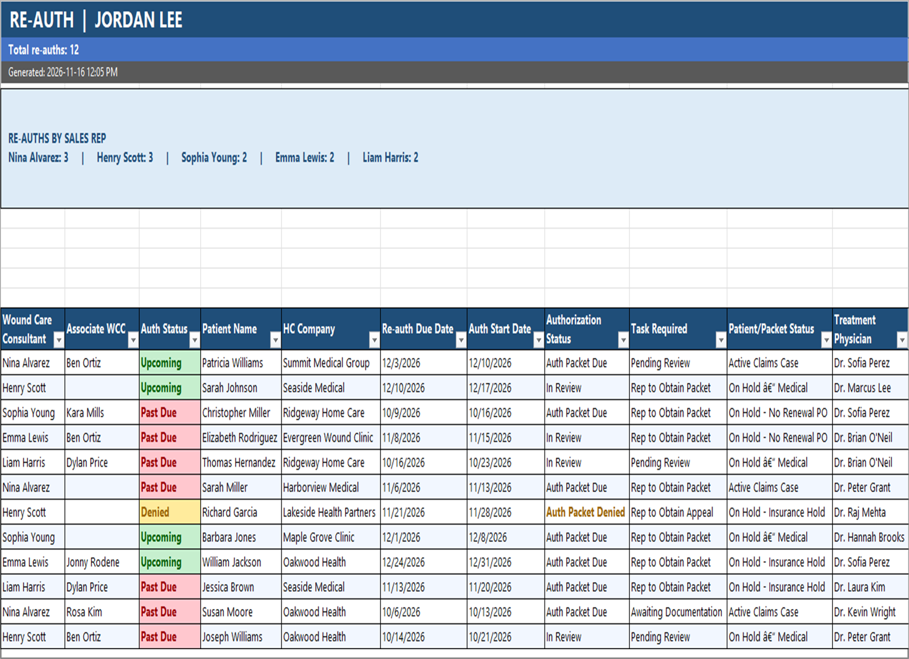
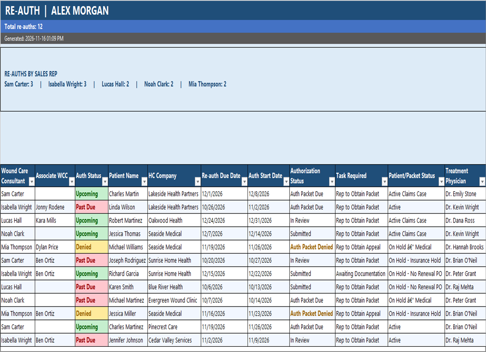
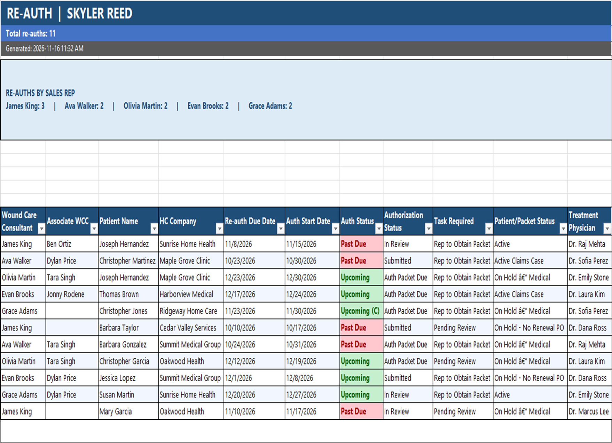
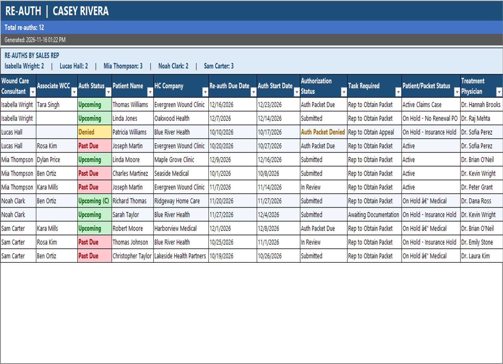
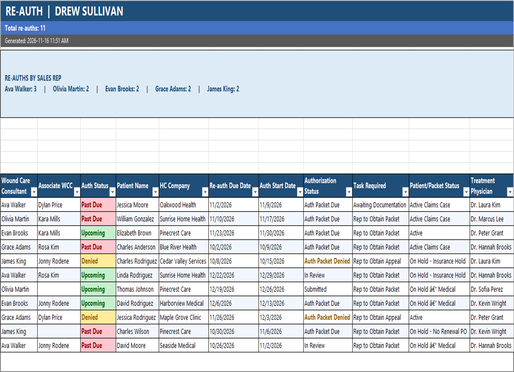
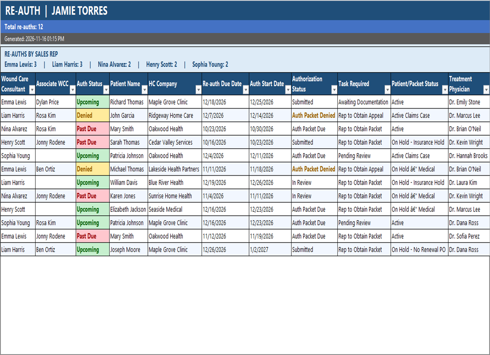

# Re-Auth Report Builder

Automated Excel/VBA report builder for **weekly pending and upcoming patient re-authorizations**. It transforms a raw re-auth export (CSV or Excel) into a formatted, manager-ready workbook containing a KPI **Dashboard**, one **manager tab** per Assigned Sales Manager (plus `Unassigned`), and a full-fidelity **Raw Data** tab.

- **Repository:** https://github.com/smd3235/Re-Auth-Project
- **Template:** `Re-Auth Template.xlsm` (macro entry: `CreateReAuthReport`, button **CREATE RE-AUTH REPORT** on `START HERE`)
- **Sample input:** `reauth raw.csv` (fake/sample data only)
- **Output:** `Reports\ReAuth_Report_YYYY-mm-dd_HHMM.xlsx`
- **Latest generated sample:** `Reports\ReAuth_Report_2026-11-16_1253.xlsx` (source: `reauth raw.csv`, 145 rows / 12 managers / 15 WCCs, generated 2026-11-16 12:53 PM)

> **GitHub display note:** GitHub renders a repository README in the section **below** the file browser by design. This README is kept at the repo root so the overview and screenshots appear in that rendered section when viewing the repository.

---

## Screenshots

### START HERE (template)
Entry point in `Re-Auth Template.xlsm`: open the template, review the steps, and click **CREATE RE-AUTH REPORT** to select your raw re-auth export (CSV/Excel). The report is generated and saved to `Reports\` next to the template.


### Report output (latest sample)
Report screenshots below were exported from `Reports\ReAuth_Report_2026-11-16_1253.xlsx` using `scripts\snapshot-report.py` (Excel COM `CopyPicture` -> chart export). They reflect the current layout, styling, and sample data.

### Dashboard
KPI summary cards and a manager breakdown table aligned edge-to-edge across columns A:J.


### Manager tab (example: Taylor Brooks)
Each manager receives a dedicated tab with title/totals, a per-rep summary block, and a single filtered data table (header row 7, data from row 8, frozen at `A16`).


### Additional manager tabs
<details>
<summary>Expand to view all other manager tabs and Unassigned</summary>

**Riley Chen**  


**Cameron Diaz**  


**Avery Johnson**  


**Jordan Lee**  


**Alex Morgan**  


**Parker Nguyen**  


**Morgan Patel**  


**Skyler Reed**  


**Casey Rivera**  


**Drew Sullivan**  


**Jamie Torres**  


**Unassigned** (records with no Assigned Sales Manager)  


</details>

### Raw Data
All source rows and all original columns preserved in original order (formatted/filterable).


---

## What the report does

1. Reads a raw re-auth dataset (`.csv`/`.xlsx`/`.xlsm`/`.xls`).
2. Detects the header row and required columns; normalizes key date fields when parseable.
3. Groups records by **Assigned Sales Manager** (blank manager → **Unassigned**).
4. Builds a styled output workbook:
   - **Dashboard** with KPI totals, status distribution, and manager-level breakdown/hyperlinks.
   - **One tab per manager** with a per–Sales Rep (Wound Care Consultant) count summary and a curated working table.
   - **Raw Data** with every original field intact.
5. Saves to `Reports\ReAuth_Report_YYYY-mm-dd_HHMM.xlsx` and writes runtime logs/completion markers for traceability.

---

## Quick start

### End users (Excel, Windows)
1. Use the latest **`Re-Auth Template.xlsm`** from this repo (macros prebuilt) in a trusted local/writable folder (e.g. `C:\ReAuth\`). `Reports\` and `log\` are created next to the template.
2. **If macros are blocked as “untrusted source”:** close Excel, right-click the `.xlsm` → **Properties** → check **Unblock** → **Apply/OK**, then reopen. PowerShell alternative: `Unblock-File .\Re-Auth Template.xlsm`. If there is no Unblock checkbox or policy still blocks it, move to a **Trusted Location** or use the **Build locally** steps below (no Python required).
3. Enable macros/content if prompted.
4. Go to **`START HERE`** and click **`CREATE RE-AUTH REPORT`**.
5. Select the raw re-auth file when prompted.
6. Wait for completion; the report is saved to `Reports\ReAuth_Report_YYYY-mm-dd_HHMM.xlsx`. On failure the dialog shows the error/line and log folder; check `log\macro-debug.log` and `log\reauth-complete.txt`.

### Maintainers (unattended / CLI)
**Prerequisites:** Windows, desktop Excel (COM), Python 3, `pywin32` (`win32com`). For sync/compile tooling, Excel must allow programmatic access to the VBA project (Trust access to the VBA project object model).

```powershell
cd "C:\Users\smd32\Downloads\Re-Auth Project"

# 1) Sync VBA source modules into the template
python .\scripts\sync_template.py

# 2) Compile-check embedded VBA
python .\scripts\test-compile.py

# 3) Generate a report (unattended; prefers absolute source path)
python .\scripts\run-report.py --source "$PWD\reauth raw.csv"

# 4) Capture clean README screenshots from newest report
python .\scripts\snapshot-report.py

# (optional) reorder/view runtime logs newest-first
python .\scripts\view-logs.py
```

`scripts\run-report.py` runs `CreateReAuthReport` via COM, manages `log\auto-source.txt`, auto-answers common dialogs, enforces a watchdog, and prints `OUTCOME=` / `NEW_REPORT=`.

### Quick download (no full repo clone)
- **[Re-Auth-Local-Build.zip](Re-Auth-Local-Build.zip)** — macro-free base (`Re-Auth Template (No Macros).xlsx`) + all 5 `mod*.bas` files + build instructions. Extract to a local folder, import all 5 `.bas` modules in Excel (Alt+F11 → File → Import), save as `.xlsm`, and run. No Python required.
- **[Re-Auth Template.xlsm](Re-Auth Template.xlsm)** — prebuilt macro-enabled template (use directly if not blocked by policy; Unblock/Trusted Location may be required).

### Build locally (avoid "untrusted macros" block)
If downloading `Re-Auth Template.xlsm` is blocked by Mark-of-the-Web on a work PC, build the macro-enabled workbook **locally** so the saved file is trusted as a local document:

1. Copy the project files to a local/trusted folder on that PC (template/base, `mod*.bas`, `scripts/`, `reauth raw.csv` as needed). If Windows blocked them, Unblock the files/folder first (`Unblock-File` or Properties → Unblock).
2. Use **`Re-Auth Template (No Macros).xlsx`** (macro-free base, included in repo) or a locally saved copy.
3. Ensure Excel allows programmatic VBA access (Trust Center → Macro Settings → **Trust access to the VBA project object model**) and macros are permitted per policy.
4. Run: `python .\scripts\sync_template.py --template "Re-Auth Template (No Macros).xlsx"`  
   This imports `mod*.bas`, creates/links the **CREATE RE-AUTH REPORT** button, and saves **`Re-Auth Template.xlsm`** locally.
5. **No Python / manual build:** open `Re-Auth Template (No Macros).xlsx` locally, Alt+F11 → File → **Import File…** and import **all 5** modules — `modCore.bas`, `modDeclarations.bas`, `modFormatting.bas`, `modLogging.bas`, `modUtils.bas` (replace existing modules if prompted). Confirm button `btnCreateReAuthReport` runs `CreateReAuthReport` (`START HERE`), then save as **Excel Macro-Enabled Workbook (*.xlsm)** in a trusted/local writable folder.
6. **Important:** if you previously imported older `.bas` files and get errors, re-import the latest `mod*.bas` from this repo (paths/logging/error reporting were made portable and more detailed). After a failure, check the `log\` folder next to the template for `macro-debug.log` and `reauth-complete.txt` (the error dialog also shows the log path and error line).

---

## Input data contract

### Supported formats
- `.csv`, `.xlsx`, `.xlsm`, `.xls`
- Blank cells are allowed and preserved where applicable.

### Required headers (auto-detected)
The macro scans for a header row containing at least:
- `Assigned Sales Manager`
- `Auth Status`
- `Patient Name`
- `Re-auth Due Date`

### Common schema fields (sample: `reauth raw.csv`)
`Wound Care Consultant`, `Associate WCC`, `Re-auth Due Date`, `HC Company`, `Patient Name`, `Patient/Packet Status`, `Task Required`, `Auth Start Date`, `Auth Status`, `Authorization Status`, `Authorization Sub Status`, `Pending SO Amount`, `Initial Authorization Denial Date`, `Authorization Denial Reason`, `Denial Reason Sub List`, `Sales Order RX Qty Requested`, `Sales Order RX Qty Approved`, `Treatment Physician`, `Treatment Physician NPI Number`, `Assigned Sales Manager`.

### Data handling rules
- **Manager grouping:** `Assigned Sales Manager` groups rows into tabs; empty/blank → `Unassigned`.
- **Status bucketing (Dashboard/summary):** `Auth Status` evaluated case-insensitively — contains `past due` → Past Due, `upcoming` → Upcoming, `denied` → Denied, else Other.
- **Date normalization:** Key date columns (e.g. `Re-auth Due Date`, `Auth Start Date`, denial date where applicable) are normalized to Excel dates and formatted when parseable; non-parseable values remain as-is.
- **CSV note:** Malformed delimiter/encoding can cause misaligned columns; re-export as clean CSV or `.xlsx` if headers/values do not import correctly.

---

## Output specification (sheet by sheet)

### 1) Dashboard
- **Title:** `RE-AUTHORIZATION DASHBOARD` with generation timestamp and source filename.
- **KPI cards (A:J grid):** `TOTAL RE-AUTHS`, `PAST DUE`, `UPCOMING`, `DENIED`, `OTHER`.
- **Manager breakdown (aligned to A:J):** `Assigned Sales Manager`, `Total`, `Past Due`, `% Past Due` (highlighted at elevated rates), and `Tab` hyperlink (“Open”) to each manager sheet.
- Styled header banding, frozen header area, and consistent column alignment/widths for edge-to-edge readability.

### 2) Manager tabs (one per manager + Unassigned)
- Layout is a single section per tab (one title/summary block and one data table). Split/freeze panes are cleared and left disabled to prevent Excel from showing a duplicated/cloned split view (e.g. A1 highlighted in two panes).
- **Title block:** `RE-AUTH  |  <MANAGER NAME>`, `Total re-auths: N`, generated timestamp.
- **Per-rep summary:** merged block **`A5:K9`** labeled `RE-AUTHS BY SALES REP` showing counts per `Wound Care Consultant` within the manager’s records.
- **Data table:** header at **row 15**, data starts at **row 16**, autofilter enabled, freeze panes at **`A16`**.
- **Columns (in order):**
  1. `Wound Care Consultant`
  2. `Associate WCC`
  3. `Patient Name`
  4. `HC Company`
  5. `Re-auth Due Date`
  6. `Auth Start Date`
  7. `Auth Status`
  8. `Authorization Status`
  9. `Task Required`
  10. `Patient/Packet Status`
  11. `Treatment Physician`
- **Excluded from manager tabs (available in Raw Data):** `Assigned Sales Manager`, `Treatment Physician NPI Number`, `Pending SO Amount`, `Sales Order RX Qty Requested`, `Sales Order RX Qty Approved`, `Authorization Sub Status`, `Initial Authorization Denial Date`, `Authorization Denial Reason`, `Denial Reason Sub List`.
- **Formatting:** Segoe UI styling, bordered table with alternating row bands by Sales Rep/Wound Care Consultant group (not per-row), date formatting on key fields, status-based highlighting (e.g. Past Due / Upcoming / Denied). Light-blue fill is applied only to empty spacer/gap areas with no data (between the rep summary block and the table header) with gridlines off on manager tabs; the rest of the sheet is not fully shaded.

### 3) Raw Data
- Contains **all rows** from the source with **all original columns in original order**.
- Header formatting, borders, autofilter, frozen header row, and date normalization/formatting on key date columns.

---

## Repository layout

| Path | Purpose |
|---|---|
| `Re-Auth Template.xlsm` | Master macro-enabled template (START HERE + embedded VBA + button) |
| `modCore.bas` | Main workflow (`CreateReAuthReport`): load, parse, group, build sheets, save, error handling |
| `modDeclarations.bas` | Constants/headers/paths and shared runtime state (`PROJECT_ROOT`, log/marker paths, layout constants) |
| `modFormatting.bas` | Dashboard, manager, and Raw Data formatting, KPI cards, rep-summary block, status highlights |
| `modLogging.bas` | Realtime/per-run logging, step/error logging, completion marker |
| `modUtils.bas` | Header/date/array utilities, sheet naming, output path, output array builders |
| `reauth raw.csv` | Sample/fake raw input used for test/report generation |
| `scripts/sync_template.py` | Import `mod*.bas` into template and refresh `btnCreateReAuthReport` → `CreateReAuthReport` |
| `scripts/run-report.py` | Robust unattended COM harness (temp copy, auto-source, dialog auto-answer, watchdog, logs, outcome detection) |
| `scripts/test-compile.py` | VBA compile probe (`COMPILE_OK`) |
| `scripts/watch-compile-error.py` | Capture/dismiss Excel/VBA compile/runtime dialogs |
| `scripts/answer-dialogs.py` | Standalone dialog auto-answer helper |
| `scripts/snapshot-report.py` | Export all (or selected) report sheets to PNG screenshots in `documentation/screenshots/` |
| `scripts/view-logs.py` | Reorder runtime logs newest-first for review |
| `documentation/screenshots/` | Committed README screenshots (generated from sample report) |
| `Reports/` | Generated `.xlsx` outputs (gitignored) |
| `log/` | Runtime logs/markers/diagnostics (gitignored except `log/.gitkeep`) |

---

## Screenshot / report capture workflow

`scripts/snapshot-report.py` is the project’s image-capture tool for README/review assets (adapted from the Pending Pickup project pattern):

- Finds the newest workbook in `Reports\` by default (or use `--path`).
- Opens Excel via COM, activates each sheet, copies `UsedRange` as a picture, pastes/exports via a chart object to PNG.
- Writes to `documentation/screenshots/` with deterministic names (`report-dashboard.png`, `report-<sheet>.png`, `report-raw-data.png`).
- By default clears existing PNGs in the output folder before a full export so screenshots stay in sync with the selected report. Use `--keep` to add/update specific sheets without removing others (recommended for partial runs).

Examples:
```powershell
# Export all sheets from the newest report
python .\scripts\snapshot-report.py

# Export from a specific report
python .\scripts\snapshot-report.py --path "Reports\ReAuth_Report_2026-11-16_1253.xlsx"

# Export specific sheets only
python .\scripts\snapshot-report.py --sheets Dashboard "Taylor Brooks" "Raw Data"

# List sheets without exporting
python .\scripts\snapshot-report.py --list
```

---

## Logging, diagnostics, and troubleshooting

### Key runtime artifacts (`log/`)
| File | Purpose |
|---|---|
| `macro-debug.log` | Always-on VBA step/error trace across runs |
| `reauth-complete.txt` | Completion marker with saved path / failure message and run log reference |
| `reauth_YYYY-mm-dd_HHMMSS.log` | Per-run logs (Python harness and/or VBA run context/tail) |
| `answer-dialogs.log` | Dialog detection and auto-answer actions |
| `watcher.log` | Captured VBA/Excel compile/runtime dialog text |
| `compile-test.log` | Compile probe output |

### Common checks
```powershell
python .\scripts\view-logs.py
python .\scripts\test-compile.py
python .\scripts\run-report.py --source "$PWD\reauth raw.csv"
```

### Troubleshooting notes
- **Macros blocked (“Microsoft has blocked macros from running because the source of this file is untrusted”):** Files downloaded/copied from the internet or email can carry a Mark-of-the-Web and be blocked by modern Excel security. Fix: close Excel → right-click `Re-Auth Template.xlsm` → **Properties** → enable **Unblock** → Apply/OK → reopen (or run `Unblock-File .\Re-Auth Template.xlsm` in PowerShell). If your org hides Unblock or enforces stricter policy, place the file in an approved **Trusted Location**, or have IT trust/sign the workbook (e.g. trusted publisher/certificate) per company policy. Avoid disabling macro security globally.
- **VBA compile issues:** run `scripts\test-compile.py` and inspect `log\compile-test.log` / `log\watcher.log`.
- **Dialogs/hangs:** `scripts\run-report.py` and `scripts\answer-dialogs.py` attempt to auto-dismiss common Excel/VBA prompts; check `log\answer-dialogs.log`.
- **Source path errors:** the harness now resolves the source to an absolute path before passing it to VBA (avoids failures like `Couldn't find .\reauth raw.csv` from a different working context).
- **Template/VBA drift:** after editing `.bas` files, run `scripts\sync_template.py` and verify compile/run; do not assume the embedded template is current without sync.
- **Headers not found:** confirm required header names exist in a detectable header row.

---

## Configuration and environment notes

- **Platform:** Windows + desktop Excel required (VBA and COM automation). `scripts\run-report.py` targets Office 16.0 HKCU macro/trusted-location settings for unattended execution.
- **Project paths:** runtime paths are resolved from the template location (`ThisWorkbook.Path`): `Reports\` for output and `log\` for diagnostics/markers are created next to the template/workbook (portable across PCs). Keep the template and its folders in a writable local location.
- **Macro security:** users must enable macros; maintainers need “Trust access to the VBA project object model” for sync/compile/snapshot tooling.
- **Git/versioning:** VBA source of truth is `mod*.bas`; `Re-Auth Template.xlsm` is the distributable embedded artifact. Generated reports/logs and local debug/temp files are gitignored.

---

## Validation (latest)
- `python .\scripts\test-compile.py` → `RESULT: COMPILE OK`, `COMPILE_OK=1`
- `python .\scripts\run-report.py --source "$PWD\reauth raw.csv"` → `OUTCOME=SUCCESS`, `NEW_REPORT=...\Reports\ReAuth_Report_2026-11-16_1253.xlsx`
- `python .\scripts\snapshot-report.py --path "Reports\ReAuth_Report_2026-11-16_1253.xlsx"` → exported dashboard, 12 manager tabs, `Unassigned`, and `Raw Data` to `documentation/screenshots/`

## Known limitations / data safety
- Large exports may increase runtime/memory usage in Excel.
- Significant schema/header changes require VBA updates.
- Do **not** commit PHI or real patient exports; keep committed sample data fake (`reauth raw.csv`).
