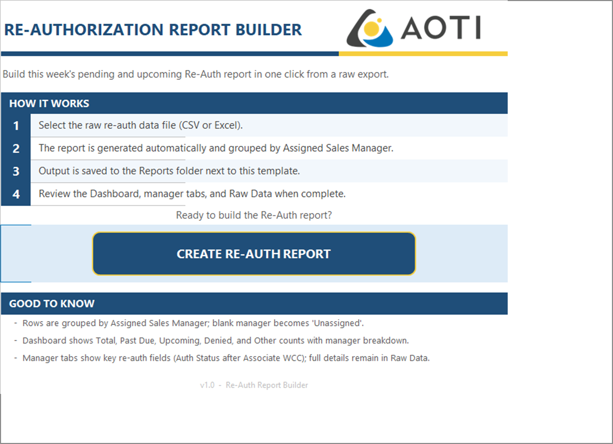
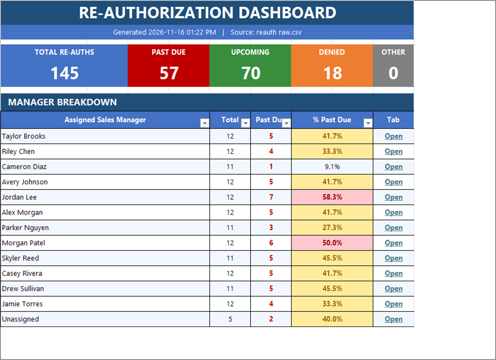
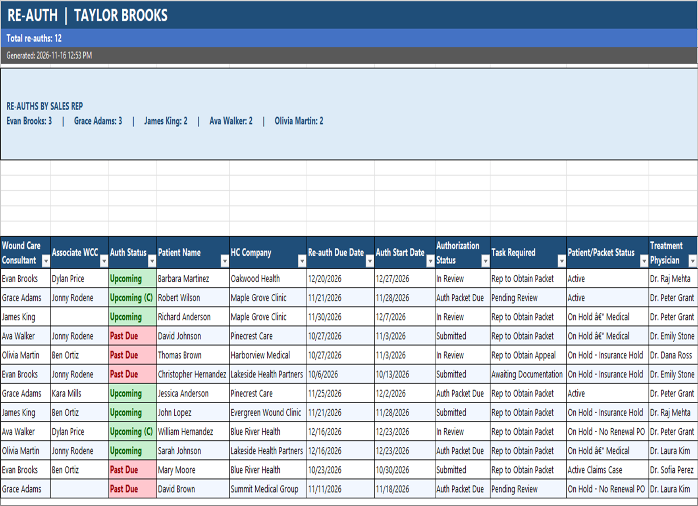
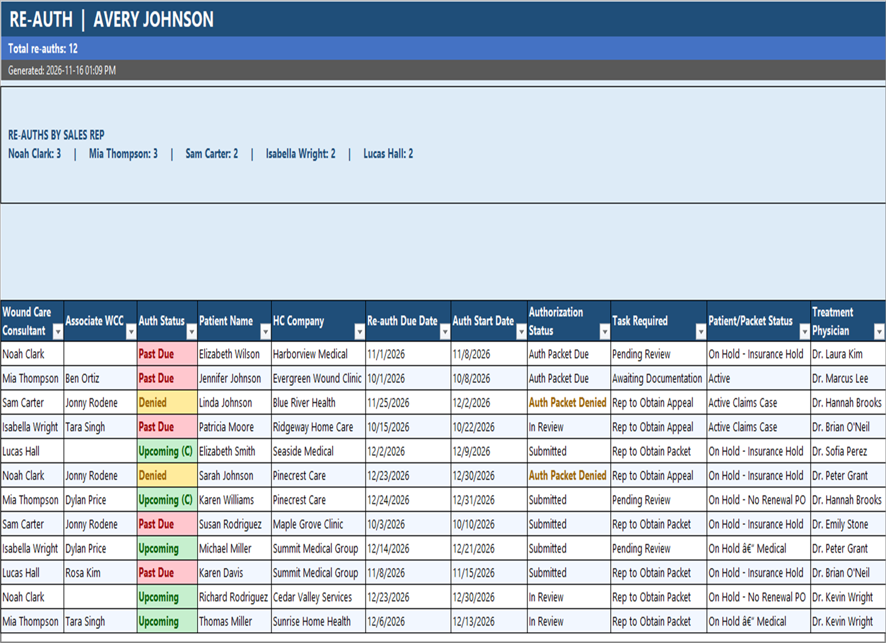
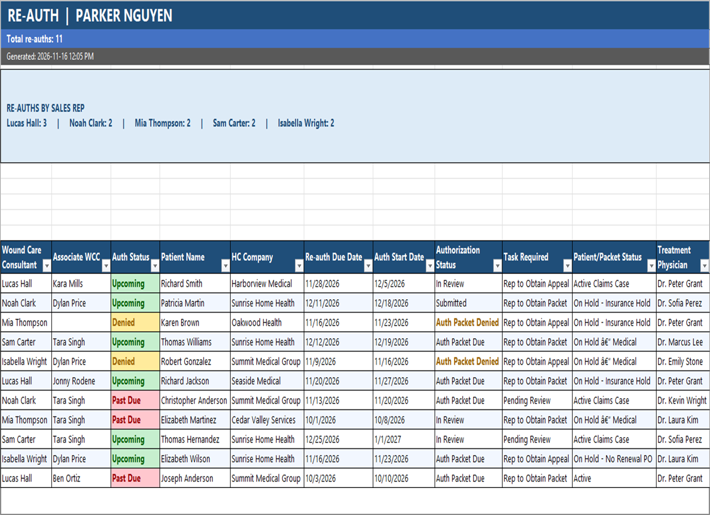

# Re-Auth Report Builder

[](https://github.com/smd3235/Re-Auth-Project/stargazers)
[](https://github.com/smd3235/Re-Auth-Project/network/members)
[](https://opensource.org/licenses/MIT)
[](https://www.python.org/downloads/)
[](https://github.com/astral-sh/ruff)
[](https://github.com/pre-commit/pre-commit)

Automated Excel/VBA report builder for **weekly pending and upcoming patient re-authorizations**. It
turns a raw re-auth export (CSV or Excel) into a formatted, manager-ready workbook with a KPI
**Dashboard**, one tab per **Assigned Sales Manager** (plus `Unassigned`), and a full-fidelity **Raw
Data** tab.

- **Repository:** https://github.com/smd3235/Re-Auth-Project
- **Template:** `Re-Auth Template.xlsm` — macro `CreateReAuthReport`, button **CREATE RE-AUTH
  REPORT** on `START HERE`
- **Sample input:** `reauth raw.csv` (fake/sample data only)
- **Output:** `Reports/ReAuth_Report_YYYY-mm-dd_HHMMSS.xlsx`
- **VBA source of truth:** `vba/mod*.bas` (the `.xlsm` is generated from them)

______________________________________________________________________

## Screenshots

### START HERE

Open the template, review the steps, and click **CREATE RE-AUTH REPORT** to pick the raw export.
Output and diagnostics are written next to the template.



### Dashboard

KPI cards (Total, Past Due, Upcoming, Denied, Other) plus a manager breakdown with per-manager
links.



### Manager tab

Title/summary, a merged `RE-AUTHS BY SALES REP` block (rows 5–6), and one data table starting at
header row 7.



<details>
<summary>Show all other manager tabs</summary>

**Riley Chen**\


**Cameron Diaz**\


**Avery Johnson**\


**Jordan Lee**\


**Alex Morgan**\


**Parker Nguyen**\


**Morgan Patel**\


**Skyler Reed**\


**Casey Rivera**\


**Drew Sullivan**\


**Jamie Torres**\


**Unassigned** (no Assigned Sales Manager)\


</details>

### Raw Data

All source rows and columns preserved in original order (formatted and filterable).


> Screenshots were exported from `Reports/ReAuth_Report_2026-11-16_1322.xlsx` with
> `scripts/snapshot-report.py`.

______________________________________________________________________

## What it does

1. Reads a raw dataset (`.csv`, `.xlsx`, `.xlsm`, `.xls`).
1. Detects the header row and maps required columns; normalizes parseable dates.
1. Groups records by **Assigned Sales Manager** (blank → `Unassigned`).
1. Builds:
   - **Dashboard** — KPI cards, manager breakdown, links to manager tabs.
   - **Manager tabs** — per-manager totals, per-rep summary, curated working table.
   - **Raw Data** — every original column in original order.
1. Saves to `Reports/` and writes run logs, diagnostics, and a completion marker.

______________________________________________________________________

## Quick start

### End users (Excel on Windows)

1. Put `Re-Auth Template.xlsm` in a trusted, writable local folder (e.g. `C:\ReAuth\`). `Reports/`
   and `log/` are created next to it.
1. If macros are blocked, close Excel, right-click the file → **Properties** → **Unblock** → Apply,
   or run `Unblock-File '.\Re-Auth Template.xlsm'`. Use a Trusted Location if policy requires it.
1. Open the template and enable macros.
1. Go to **START HERE** → **CREATE RE-AUTH REPORT** → select the raw file.
1. The report is saved to `Reports/ReAuth_Report_YYYY-mm-dd_HHMMSS.xlsx`. On failure the dialog
   shows error/line/step; check `log/macro-debug.log` and `log/reauth-complete.txt`.

### Maintainers (unattended / CLI)

**Prerequisites:** Windows, desktop Excel (COM), Python 3, `pywin32`, `psutil`. Excel must allow
*Trust access to the VBA project object model*.

```powershell
cd "C:\Users\smd32\Downloads\Re-Auth Project"

python .\scripts\sync_template.py      # import vba/mod*.bas into the template
python .\scripts\test-compile.py       # VBA compile probe -> COMPILE_OK=1
python .\scripts\run-report.py --source "$PWD\reauth raw.csv"
python .\scripts\verify-report.py      # structure/content validation
python .\scripts\scan-logs.py          # syntax/lint/log scan -> 0 current issues
```

Optional:

```powershell
python .\scripts\monitor-logs.py              # newest run summary
python .\scripts\monitor-logs.py --follow     # live tail with error/stall alerts
python .\scripts\view-logs.py                 # newest-first copies in log/views/
python .\scripts\snapshot-report.py           # export screenshots
python .\scripts\cleanup.py                   # dry run retention cleanup
python .\scripts\cleanup.py --apply --archive # prune/archive old logs and reports
python .\scripts\scan-logs.py --history       # include pre-fix logs
python .\scripts\scan-logs.py --repair        # fix corrupt/reordered logs (.orig backups)
```

`run-report.py` validates inputs before starting (template/source/CSV headers), manages
`log/auto-source.txt`, auto-answers common dialogs, runs a watchdog, verifies the saved workbook,
releases COM handles, terminates only Excel processes it started, and prints `OUTCOME=` /
`NEW_REPORT=`.

### Quick download (no repo clone)

- **`Re-Auth-Local-Build.zip`** — macro-free base, all 5 `.bas` modules, and build instructions.
- **`Re-Auth Template.xlsm`** — prebuilt template (Unblock/Trusted Location may be required).

### Build locally (avoid blocked macros)

1. Copy the project to a local/trusted folder and unblock the files.
1. Use `Re-Auth Template (No Macros).xlsx` as the base.
1. With Python: `python .\scripts\sync_template.py --template "Re-Auth Template (No Macros).xlsx"` —
   imports `vba/mod*.bas`, wires the button, saves `Re-Auth Template.xlsm`.
1. Without Python: open the base `.xlsx`, Alt+F11 → **File → Import File…**, import all 5 modules
   from `vba/`, confirm `btnCreateReAuthReport` → `CreateReAuthReport`, then **Save As** `.xlsm`.

______________________________________________________________________

## Input data contract

**Formats:** `.csv`, `.xlsx`, `.xlsm`, `.xls`. Blank cells are preserved.

**Required headers (auto-detected):** the first row containing at least **3 of 4** of:
`Assigned Sales Manager`, `Auth Status`, `Patient Name`, `Re-auth Due Date`. A missing
`Assigned Sales Manager` column places every row in `Unassigned`; other missing fields are logged as
warnings.

**Sample schema (20 columns):** `Wound Care Consultant`, `Associate WCC`, `Re-auth Due Date`,
`HC Company`, `Patient Name`, `Patient/Packet Status`, `Task Required`, `Auth Start Date`,
`Auth Status`, `Authorization Status`, `Authorization Sub Status`, `Pending SO Amount`,
`Initial Authorization Denial Date`, `Authorization Denial Reason`, `Denial Reason Sub List`,
`Sales Order RX Qty Requested`, `Sales Order RX Qty Approved`, `Treatment Physician`,
`Treatment Physician NPI Number`, `Assigned Sales Manager`.

**Rules**

- Manager grouping is case-insensitive; blank manager → `Unassigned`.
- Status buckets: contains `past due` → Past Due, `upcoming` → Upcoming, `denied` → Denied, else
  Other.
- Dates on `Re-auth Due Date`, `Auth Start Date`, and the denial date are normalized when parseable;
  unparseable values are left as-is and counted in the run log.
- Malformed CSV delimiters/encoding can misalign columns; re-export as clean CSV or `.xlsx`.

______________________________________________________________________

## Output specification

### Dashboard

- Title `RE-AUTHORIZATION DASHBOARD` with generation timestamp and source filename.
- KPI cards in `A4:J5`: `TOTAL RE-AUTHS`, `PAST DUE`, `UPCOMING`, `DENIED`, `OTHER`.
- Manager breakdown (header row 8, data from row 9): manager, total, past due, `% Past Due`
  (highlighted at elevated rates), `Open` hyperlink to the manager tab.

### Manager tabs

- Title block, total row, merged `RE-AUTHS BY SALES REP` block in rows 5–6.
- Data table header at **row 7**, data from row 8, autofilter enabled; split/freeze panes are
  cleared to avoid duplicate pane views.
- Columns in order:
  1. `Wound Care Consultant`
  1. `Associate WCC`
  1. `Auth Status`
  1. `Patient Name`
  1. `HC Company`
  1. `Re-auth Due Date`
  1. `Auth Start Date`
  1. `Authorization Status`
  1. `Task Required`
  1. `Patient/Packet Status`
  1. `Treatment Physician`
- Rows sorted by sales rep, banded by rep group, with status-based highlighting; dates formatted on
  key fields.
- Remaining source columns stay available in **Raw Data**.

### Raw Data

All rows, all original columns in original order, with header formatting, borders, autofilter, and
date normalization.

______________________________________________________________________

## Repository layout

| Path                                | Purpose                                                                         |
| ----------------------------------- | ------------------------------------------------------------------------------- |
| `Re-Auth Template.xlsm`             | Master macro-enabled workbook (START HERE, button, embedded VBA)                |
| `Re-Auth Template (No Macros).xlsx` | Macro-free base for local builds                                                |
| `vba/modCore.bas`                   | `CreateReAuthReport` workflow: parse, group, build sheets, save, error handling |
| `vba/modDeclarations.bas`           | Constants, header names, sheet names, shared runtime state                      |
| `vba/modFormatting.bas`             | Dashboard, manager tabs, Raw Data, KPI cards, rep summary                       |
| `vba/modLogging.bas`                | `LogMsg`/`LogErr`/`LogStep`, completion marker, log fallback                    |
| `vba/modUtils.bas`                  | Header/date/array helpers, paths, output naming, sheet-name safety              |
| `scripts/sync_template.py`          | Import `vba/mod*.bas` into the template and wire the button                     |
| `scripts/run-report.py`             | COM harness: preflight, dialog answerer, watchdog, output verification          |
| `scripts/test-compile.py`           | VBA compile probe (`COMPILE_OK`), hashes and Excel version                      |
| `scripts/verify-report.py`          | Workbook validation: sheets, row parity, headers, error cells, KPIs             |
| `scripts/scan-logs.py`              | Python syntax check, VBA lint, log/run consistency, `--repair`                  |
| `scripts/monitor-logs.py`           | One-shot or live run-log monitor with error/stall flags                         |
| `scripts/view-logs.py`              | Newest-first copies in `log/views/` (originals untouched)                       |
| `scripts/cleanup.py`                | Retention: keep 20 run logs / 5 reports, prune or archive the rest              |
| `scripts/snapshot-report.py`        | Export report sheets to PNG for docs/review                                     |
| `scripts/watch-compile-error.py`    | Capture/dismiss Excel/VBA dialogs into `log/watcher.log`                        |
| `scripts/answer-dialogs.py`         | Standalone dialog auto-answer helper                                            |
| `AGENTS.md`                         | Agent/maintainer conventions and validation checklist                           |
| `documentation/screenshots/`        | Committed screenshots                                                           |
| `Reports/`, `log/`                  | Generated artifacts (gitignored); old items under `archive/`                    |

______________________________________________________________________

## Logs and diagnostics

| File                      | Writer           | Contents                                                                                               |
| ------------------------- | ---------------- | ------------------------------------------------------------------------------------------------------ |
| `log/reauth_<stamp>.log`  | harness + VBA    | Preflight, environment, step/context lines, outcome; VBA log lines are duplicated with a `VBA ` prefix |
| `log/macro-debug.log`     | VBA              | Always-on step/error trace                                                                             |
| `log/reauth-complete.txt` | VBA              | `completed`, `saved`, `run_log`, `step`, `version` (or failure text)                                   |
| `log/auto-source.txt`     | harness          | Absolute source path consumed by VBA                                                                   |
| `log/answer-dialogs.log`  | harness / helper | Dialog detection and auto-answer actions                                                               |
| `log/watcher.log`         | watcher          | Captured compile/runtime dialog text                                                                   |
| `log/compile-test.log`    | compile probe    | Module hashes/line counts, Excel version, result                                                       |
| `log/sync-template.log`   | sync             | Imported module line counts, save path, result                                                         |
| `log/verify-report.log`   | verifier         | Structure/content check results                                                                        |
| `log/cleanup.log`         | cleanup          | Applied retention actions                                                                              |
| `log/probe_ran.txt`       | compile probe    | Probe marker (`ran`)                                                                                   |

`scripts/scan-logs.py` checks Python syntax, lints VBA (`Option Explicit`, missing `On Error GoTo`
labels, procedure/End mismatch, non-ASCII characters), verifies run consistency (row counts,
tab/format completion, timestamp order), detects report-name reuse, stale temp/lock files,
auto-source drift, completion-marker mismatches, and orphan Excel processes. Old logs are treated as
historical, not current failures.

______________________________________________________________________

## Development tooling

Installed tooling is wired into `pyproject.toml` and the validation flow:

| Tool          | Purpose                                                                                                                       | Command                                                                                               |
| ------------- | ----------------------------------------------------------------------------------------------------------------------------- | ----------------------------------------------------------------------------------------------------- |
| ruff          | Lint + format for `scripts/` and `tests/`                                                                                     | `python -m ruff check scripts tests` / `python -m ruff format --check scripts tests`                  |
| mypy          | Static type check for pure-Python scripts                                                                                     | `python -m mypy scripts\scan-logs.py scripts\cleanup.py scripts\view-logs.py scripts\monitor-logs.py` |
| pytest        | Unit tests in `tests/` (temp-dir based, no Excel needed)                                                                      | `python -m pytest`                                                                                    |
| pyvbaanalysis | Real VBA parser used by `scripts\scan-logs.py` for `vba/mod*.bas` lint (cross-module references resolved via a project index) | part of `python .\scripts\scan-logs.py`                                                               |
| openpyxl      | Available for COM-free `.xlsx` inspection if needed                                                                           | —                                                                                                     |

## Validation checklist

1. `python .\scripts\test-compile.py` → `COMPILE_OK=1`.
1. `python .\scripts\run-report.py` → `OUTCOME=SUCCESS` with a `NEW_REPORT=` path.
1. `python .\scripts\verify-report.py` → 0 errors/warnings.
1. `python .\scripts\scan-logs.py` → 0 current issues.
1. Latest run logs contain no `Err=0` lines and no `| ERROR |` entries.

______________________________________________________________________

## Troubleshooting

- **Macros blocked:** unblock the file or use a Trusted Location / IT-signed workbook. Do not
  disable macro security globally.
- **Compile or runtime dialogs:** run `scripts\test-compile.py`; inspect `log\compile-test.log` and
  `log\watcher.log`.
- **Hanging runs:** `run-report.py` answers common dialogs and enforces a watchdog; check
  `log\answer-dialogs.log` and the run log.
- **Source not found:** the harness passes an absolute path and validates it first; confirm
  `reauth raw.csv` exists or pass `--source`.
- **Headers not found:** verify the required header names; the run log lists detected/missing
  columns.
- **Template drift:** after editing `.bas`, always run `sync_template.py` before testing — the
  `.xlsm` does not update itself.
- **Orphan Excel:** the harness cleans up only the process it started; other Excel sessions are
  never killed.

______________________________________________________________________

## Maintenance rules

- Edit `vba/mod*.bas` only; never edit embedded VBA directly in the `.xlsm`.
- Keep `Option Explicit` and `Attribute VB_Name`; route errors through `LogErr` with captured values
  (no `Err=0` noise).
- After VBA edits: `sync_template.py` → `test-compile.py` → `run-report.py` → `verify-report.py` →
  `scan-logs.py`.
- Run Python scripts from the repo root; all scripts must byte-compile.
- Do not commit `Reports/`, `log/`, temp workbooks, or real/PHI data. Sample data must stay fake.

______________________________________________________________________

## Limitations and data safety

- Very large exports increase Excel memory/runtime.
- Major schema changes require VBA header/column updates.
- Never commit real patient data; keep `reauth raw.csv` synthetic.
